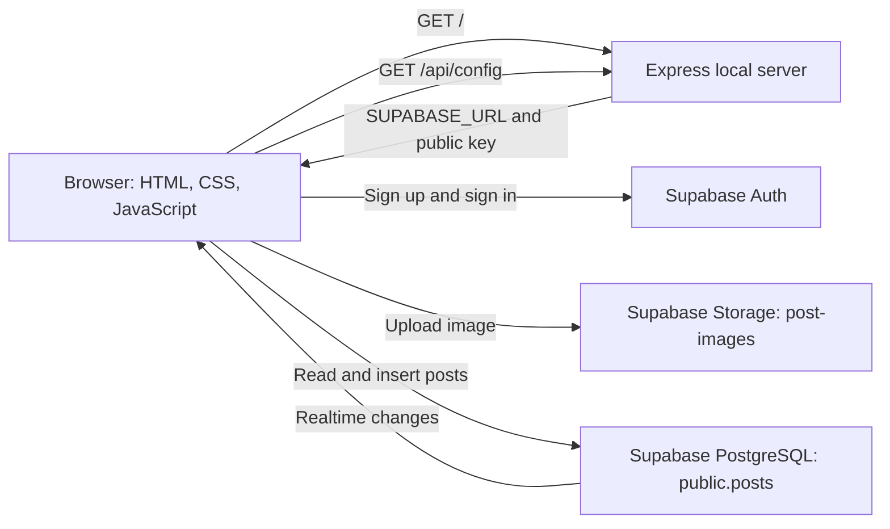

# InstaLite

InstaLite is a small Instagram-inspired photo-sharing application and learning project. It is designed to help beginners see how a browser interface works with authentication, a PostgreSQL database, image storage, and realtime updates.

The current application uses **Supabase**, not Firebase. The interface is built with HTML, CSS, and vanilla JavaScript. Express serves the files locally and returns the public Supabase client configuration; the browser then communicates directly with Supabase.

## Features

- Responsive, Instagram-inspired layout with a photo feed, sample stories, and suggested profiles.
- Email-and-password account creation and sign-in through Supabase Auth.
- Image selection, drag-and-drop, preview, and removal in the Create Post dialog.
- Post images in JPEG, PNG, or WebP format, up to 5 MB, as checked by the browser before upload.
- Authenticated image uploads to the `post-images` Supabase Storage bucket.
- Post records in PostgreSQL, with a feed that loads up to the 30 newest posts.
- Supabase Realtime subscription that reloads the feed when `public.posts` changes.
- Loading, empty-feed, and error feedback.
- Local development server and a Node test suite.

Search, Explore, Notifications, following, likes, comments, bookmarks, story playback, profile editing, and avatar uploads are not implemented. Their appearance in the interface does not mean those actions work.

## How the application works



Express does **not** receive post or image-upload requests. It serves the static application and the `GET /api/config` endpoint. The browser loads Supabase JavaScript v2 from `esm.sh`, reads `/api/config`, and uses the public client key to call Supabase Auth, Storage, and PostgreSQL directly.

When someone shares a post, the browser:

1. Confirms a user session with Supabase Auth.
2. Checks that an image is selected and that the browser-reported type and size are allowed.
3. Uploads the image to `post-images` at `posts/<authenticated-user-id>/<random-uuid>.<extension>`.
4. Gets a public URL for the uploaded image.
5. Inserts the post metadata into `public.posts`, using the same authenticated user ID.
6. Removes the uploaded image if the database insert fails. If cleanup is also rejected, the browser logs that cleanup error.

The feed selects the newest 30 rows from `public.posts`. A Supabase Realtime subscription listens for changes to that table and reloads the feed.

## Technology

| Area | Technology | Role |
| --- | --- | --- |
| Frontend | HTML5, CSS3, vanilla JavaScript ES module | Interface, form validation, Supabase client calls, and rendering |
| Supabase client | `@supabase/supabase-js` v2, loaded from `https://esm.sh/` | Browser-side Auth, Storage, PostgreSQL, and Realtime access |
| Local server | Node.js and Express | Serves `public/` and returns public client config at `/api/config` |
| Data and identity | Supabase PostgreSQL and Supabase Auth | Stores posts and manages email/password accounts |
| Image storage | Supabase Storage | Stores post image objects in `post-images` |
| Node tests | Node's built-in test runner | Checks Express endpoints and source/schema expectations |
| Browser tests | Playwright Test with Chromium | Tests the browser-facing app shell |

### Dependencies

These are the dependencies declared in `package.json`:

- Runtime: `express` (`^5.1.0`).
- Development/test: `@playwright/test` (`1.64.0`).
- Supabase JavaScript is loaded from a CDN by the browser; it is not an npm dependency in this project.

## Prerequisites

- Node.js 20 or newer. This is the version used by the repository's CI workflow and required by its Playwright test dependency.
- npm, which is included with Node.js.
- Git, if you are cloning or contributing to the repository.
- A Supabase account and a Supabase project to use the hosted Auth, database, and Storage services.
- A GitHub account if you want to contribute through an issue and pull request.
- An internet connection while using the browser client, which loads Supabase JavaScript from `esm.sh` and connects to Supabase.

Check Node.js and npm in PowerShell or another terminal:

```powershell
node --version
npm --version
```

## Clone and install

The repository URL below is taken from this repository's configured Git remote:

```powershell
git clone https://github.com/kachamsiddarth/instalite.git
Set-Location instalite
npm ci
```

`npm ci` installs the exact dependency versions recorded in `package-lock.json`. If you are actively changing dependencies, `npm install` is also available.

## Create a Supabase project

InstaLite needs a Supabase project because Auth, the database, and Storage are hosted by Supabase.

1. Sign in at [Supabase](https://supabase.com/dashboard).
2. Choose **New project**, select an organization, and enter a project name, database password, and region.
3. Create the project and wait until its status shows that it is ready.
4. In the project dashboard, open **Project Settings → API** or the project's **Connect** settings. Supabase may update the Dashboard labels over time.
5. Copy the **Project URL** and the **publishable client key**. An existing project may label its compatible public key as the legacy `anon` key.
6. Use the Project URL for `SUPABASE_URL` and the public key for `SUPABASE_ANON_KEY` in the next section.

The publishable/anon key is intended to be used by a browser application. It does not grant unrestricted database access: Row Level Security (RLS) policies are essential. A **service-role** or **secret** key is privileged and must never be placed in `.env` for this app, because `/api/config` sends its values to every browser.

## Configure environment variables

The Express server reads `SUPABASE_URL` and `SUPABASE_ANON_KEY` from a root `.env` file. Its `GET /api/config` endpoint returns those values to the browser as public client configuration.

Create `.env` from the example in Windows PowerShell:

```powershell
Copy-Item .env.example .env
```

Then open `.env` in an editor and replace the example values:

```dotenv
SUPABASE_URL=https://your-project.supabase.co
SUPABASE_ANON_KEY=your-public-publishable-or-anon-key
```

Use the actual Project URL and public client key from your project. Do not add quotation marks unless they are part of the value. Save the file. The checked-in `.gitignore` excludes `.env`; do not remove that protection or commit the file.

After starting the server, open <http://localhost:3000/api/config>. Confirm that `url` contains your project URL and that `anonKey` is a non-empty public key. Do not copy real values into screenshots, issues, or chat messages. This endpoint is intentionally public; it must contain only the public browser key, never a service-role/secret key.

The server reads `.env` when it starts. Restart the server after changing `.env`, then reload the app so its browser client fetches the updated configuration.

## Configure email authentication

The app uses Supabase's email-and-password sign-up and sign-in methods.

1. In the Supabase project dashboard, open **Authentication → Sign In / Providers** (the exact label can vary).
2. Open the **Email** provider and verify that email/password sign-in is enabled.
3. For this project's **development setup**, email confirmation is disabled to simplify local testing, as specified for the project. If the setting in your Dashboard differs, the Dashboard is authoritative.
4. With confirmation disabled, a successful new signup can create a session immediately. If confirmation is enabled, the user may need to confirm their email and then sign in before creating a post.

Changing the confirmation setting does not necessarily mark accounts created earlier as confirmed. If an older account cannot sign in because it is unconfirmed, use Supabase's supported confirmation/resend workflow or ask the project administrator to resolve that account. Do not assume changing the setting updates existing users.

For production, make an intentional email-verification decision and configure reliable email delivery, such as custom SMTP, if verification emails are required. Development settings are not a universal production recommendation.

## Set up the database with the project's SQL

The canonical database and Storage setup is [`supabase/schema.sql`](./supabase/schema.sql). Run the complete checked-in file in the SQL Editor; do not substitute a different schema.

1. Open this InstaLite repository in VS Code.
2. Open `supabase/schema.sql`.
3. Read through the script. It creates or configures the `public.posts` table, its index and RLS policies, the Storage bucket and policies, and the Realtime publication membership.
4. Select the entire file and copy it.
5. Open the [Supabase Dashboard](https://supabase.com/dashboard), and double-check the project name before running SQL. The script changes the selected project's database.
6. Open **SQL Editor**, create a new query, and paste the complete SQL.
7. Run the query. Review the results and resolve any SQL error before testing the app.
8. Open **Table Editor → posts** and verify the columns listed below.
9. Check the active policies in **Database → Policies** or run the read-only verification queries below.
10. Confirm `public.posts` is present in the `supabase_realtime` publication.

`supabase/schema.sql` creates one application table:

| Column | Type | Purpose and rule |
| --- | --- | --- |
| `id` | `uuid` | Primary key, generated with `gen_random_uuid()` |
| `user_id` | `uuid` | Required author ID; references `auth.users(id)` and cascades when that user is deleted |
| `username` | `text` | Required display name, 1–30 characters |
| `caption` | `text` | Required caption, 1–500 characters |
| `image_url` | `text` | Required public URL for the stored image |
| `image_path` | `text` | Required object path in Supabase Storage |
| `created_at` | `timestamptz` | Required creation time, defaults to `now()` |

The script creates the descending `posts_created_at_idx` index for feed ordering. It does not define database triggers.

The script can be rerun: it uses `IF NOT EXISTS` for the table/index, replaces its named policies, upserts the bucket, and only adds `public.posts` to `supabase_realtime` when the table is not already there. Note that `CREATE TABLE IF NOT EXISTS` does not repair a pre-existing `posts` table with a different set of columns; inspect and resolve a schema mismatch rather than assuming the script modified that table.

Useful read-only checks in the SQL Editor:

```sql
select column_name, data_type
from information_schema.columns
where table_schema = 'public' and table_name = 'posts'
order by ordinal_position;
```

```sql
select policyname, cmd, roles, qual, with_check
from pg_policies
where (schemaname = 'public' and tablename = 'posts')
   or (schemaname = 'storage' and tablename = 'objects')
order by schemaname, tablename, policyname;
```

```sql
select tablename
from pg_publication_tables
where pubname = 'supabase_realtime'
  and schemaname = 'public'
  and tablename = 'posts';
```

The table RLS policies allow public feed reads and authenticated inserts only when `user_id` equals `auth.uid()`. Updates and deletes are denied by the policies in the setup script.

## Configure Supabase Storage

The SQL script upserts a bucket named `post-images` and sets it to **public**. Open **Storage → Buckets** in the same Supabase project to verify it exists and is public. The app uses `getPublicUrl()` to construct the URL saved in `public.posts.image_url`.

Images are stored as objects, rather than binary data in PostgreSQL. The database row stores `image_url` and `image_path` alongside the caption and author.

- Object path: `posts/<authenticated-user-id>/<random-uuid>.<extension>`.
- The upload policy permits authenticated users to insert only into `post-images` under `posts/<their-auth-uid>/...`.
- The select policy permits public reads from `post-images`, which is consistent with a public bucket and public feed.
- The delete policy permits an authenticated owner to delete objects under their own path.
- The browser currently accepts JPEG, PNG, and WebP and checks that the file is at most 5 MB.

**Important:** The MIME type and 5 MB limit are checked in browser JavaScript. The SQL script does not configure a Storage file-size or MIME-type limit, so these client checks are not a server-side security boundary. Configure appropriate bucket-level restrictions before using this as a production service. A public bucket means anyone with an image URL can read that image; the insert policy still restricts who may upload.

RLS on Storage is not disabled. Do not add unrestricted insert policies or put a service-role key in the browser to work around an upload error.

## Run InstaLite locally

From the repository folder, start the Express server:

```powershell
npm start
```

This runs `node server.js`, serves the frontend from `public/`, and provides `/api/config`. Open <http://localhost:3000>. Keep the terminal running while using the site; press **Ctrl+C** in that terminal to stop the server.

If port 3000 is already in use, either stop the other process or choose another port for this PowerShell session:

```powershell
$env:PORT = '3001'
npm start
```

Then open <http://localhost:3001>. Environment changes require restarting the server and reloading the app.

There is no `npm run emulators` command or Supabase local-emulator configuration in this project. The hosted Supabase project configured in `.env` is the backend used by the current client.

## First post walkthrough

After the Supabase project, environment, SQL, Storage, and email provider are configured:

1. Start the server with `npm start` and open <http://localhost:3000>.
2. Select **Sign in**, then switch to account creation if you do not have an account.
3. Create an account and sign in. If email confirmation is enabled in the Dashboard, confirm the address and sign in again.
4. Select **Create post**.
5. Choose a JPEG, PNG, or WebP image up to 5 MB. The preview should appear.
6. Enter a caption and select **Share post**.
7. In Supabase Storage, verify that a new object appears under `post-images/posts/<your-user-id>/`.
8. In **Table Editor → posts**, verify a row with the same `user_id`, image URL, image path, and caption.
9. Verify that the post appears in the feed, then refresh and confirm the database-backed post remains visible.
10. To check Realtime, open the site in a second browser session and create a post in one session; the other feed should reload when Realtime is enabled for `public.posts`.

These checks contact the configured Supabase project and create real Auth users, Storage objects, and database rows. Use a development project and test images.

## Project structure

```text
instalite/
├── .env.example
├── .gitignore
├── CONTRIBUTING.md
├── package-lock.json
├── package.json
├── playwright.config.js
├── README.md
├── server.js
├── public/
│   ├── index.html
│   ├── style.css
│   ├── supabase-app.js
│   └── images/
│       └── default-avatar.svg
├── supabase/
│   └── schema.sql
├── test/
│   ├── app.spec.js
│   └── server.test.js
└── .github/
    └── workflows/
        └── pr-checks.yml
```

- `server.js` — Express static server and public `/api/config` endpoint.
- `public/index.html` — semantic page structure, feed shell, dialogs, and upload form.
- `public/style.css` — responsive layout and interface styles.
- `public/supabase-app.js` — Supabase client, auth flow, feed, image upload, post insertion, and Realtime subscription.
- `public/images/` — local default avatar image.
- `supabase/schema.sql` — canonical database, RLS, Storage, and Realtime setup.
- `test/server.test.js` — Node test-runner checks for server responses and key frontend/schema expectations.
- `test/app.spec.js` and `playwright.config.js` — Playwright browser tests and Chromium configuration.
- `.env.example` — names and placeholders for the public Supabase configuration.
- `.gitignore` — excludes `.env`, dependencies, generated uploads, and test output.
- `.github/workflows/pr-checks.yml` — CI workflow using Node.js 20.

## Commands and tests

The scripts below are the scripts currently declared in `package.json`:

| Command | What it does |
| --- | --- |
| `npm start` | Starts the Express server (`node server.js`) |
| `npm test` | Runs `node --test test/server.test.js` |
| `npm run test:browser` | Runs `playwright test` using `playwright.config.js` |
| `npm run deploy` | Prints a reminder to run the SQL and deploy the static site; it does **not** deploy anything |

Run the Node tests with:

```powershell
npm test
```

Playwright requires the app server to be running in one terminal and Chromium installed for Playwright. Install the browser once with:

```powershell
npx playwright install chromium
```

Then, in another terminal:

```powershell
npm run test:browser
```

The Playwright configuration targets `http://localhost:3000`, Chromium, and files matching `test/*.spec.js`. It does not start the server itself.

The browser suite has not been verified as passing in this workspace. A recent run could not launch because the Playwright Chromium executable was not installed. Also, the current browser spec contains stale expectations for a `Supabase-config.js` file and for Supabase always being unconfigured; the actual app uses `/api/config` and depends on the `.env` values. If those particular expectations fail after Chromium is installed, they are stale test assumptions, not proof that the corresponding app route or Supabase service is broken. Inspect the exact test failure and actual browser/network behavior separately.

## Troubleshooting

| Symptom | Likely cause and next step |
| --- | --- |
| “Supabase is not configured” or blank values at `/api/config` | Check that root `.env` exists and contains non-placeholder `SUPABASE_URL` and `SUPABASE_ANON_KEY` values. Restart `npm start`, then reload the page. Do not paste keys into a public issue. |
| Signup says `email rate limit exceeded` or returns HTTP 429 | Supabase is throttling email sends. Stop repeating signup/confirmation requests and wait. If the account may already exist, try **Sign in**. For ongoing development, review project Auth limits or configure custom SMTP. |
| Signup succeeds but sharing says to confirm email | The project may require confirmation and return no active session at signup. Complete the confirmation flow, then sign in. Changing that Dashboard setting does not necessarily confirm existing accounts. |
| “Invalid login credentials” | Check the email and password and confirm that the account exists in the same Supabase project configured in `.env`. Resolve an unconfirmed account through Supabase's supported confirmation workflow. |
| Storage reports `new row violates row-level security policy` | The upload happens before the database insert. First verify the signed-in Auth user and the request's bucket/path: `post-images` and `posts/<that-user-id>/<filename>`. Then inspect the active `storage.objects` INSERT policy in the same project. It should require the `authenticated` role, bucket `post-images`, first path segment `posts`, and second segment equal to `auth.uid()`. Keep RLS enabled; do not add an unrestricted policy. |
| The `post-images` bucket is missing | In the correct project's SQL Editor, run the complete `supabase/schema.sql`, then verify the bucket in **Storage → Buckets**. Check for SQL errors. |
| Image uploads, but no post row is created | Check the browser console and the `public.posts` INSERT policy. The row's `user_id` must equal the current authenticated user's UID. The app attempts to remove an uploaded image after an insert failure; check Storage too if cleanup was rejected. |
| Feed is empty or database requests fail | An empty feed is normal before any posts exist. Otherwise verify `/api/config`, the `public.posts` table, the public SELECT policy, and browser network/console errors. |
| New posts do not appear in another browser session | Verify that `public.posts` is in `supabase_realtime`, Realtime is enabled for the project, and both clients are connected to the same Supabase project. Refresh to distinguish a subscription issue from a database insert failure. |
| Port 3000 is already in use | Stop the server already using it, or start InstaLite with `$env:PORT = '3001'; npm start` and open `http://localhost:3001`. |
| Playwright says the Chromium executable is missing | Run `npx playwright install chromium`, keep `npm start` running on the configured port, and rerun `npm run test:browser`. |
| A browser test expects `Supabase-config.js` or an always-unconfigured app | That expectation is stale: current source loads `/supabase-app.js` and requests `/api/config`. Compare the test assertion with the actual source and network response before treating it as an application defect. |

For a Storage policy problem, inspect the active policy and actual request path before changing SQL. Do not disable RLS, make uploads unrestricted, expose a service-role key, or change the bucket to public as an upload workaround. The project intentionally uses a public bucket for reading the feed; that does not grant anonymous upload permission.

## Security notes

- `.env` is ignored by Git. Keep it local and never commit, screenshot, or share its contents.
- `SUPABASE_ANON_KEY` is a public browser key and is returned by `/api/config`. A service-role/secret key is privileged and must never be used there.
- RLS protects database and Storage operations even when someone bypasses the app's UI or calls Supabase directly.
- The sign-in check and file validation in JavaScript improve the user experience; they are not security boundaries. RLS and server-side/bucket-level validation are still needed.
- The `post-images` bucket is public, so image URLs can be read by anyone who has them. Do not upload private or sensitive images.
- Never include credentials, access tokens, private images, or unredacted project settings in GitHub issues, pull requests, or screenshots.

## Workshop contributions

The workshop issue for adding **likes or comments** is a future feature; neither interaction is implemented yet. Other possible follow-up issues include bookmarks, story playback, profile editing, following, and avatar uploads. Keep an issue focused and add appropriate RLS policies and tests when a change affects data access.

For a contribution:

1. Search the [GitHub issues](https://github.com/kachamsiddarth/instalite/issues) for an existing task, or create an issue describing the proposed change.
2. Fork the repository and clone your fork.
3. Create a descriptive branch, such as `add-post-comments` or `docs-supabase-setup`.
4. Make a focused change and avoid including `.env` or generated files.
5. Run relevant checks, such as `npm test`.
6. Review the diff, create a meaningful commit, and push the branch to your fork.
7. Open a pull request against this repository and reference the related issue.

See [`CONTRIBUTING.md`](./CONTRIBUTING.md) for the existing step-by-step contributor guide.

## License

No `LICENSE` file is currently present, so the project's license has not yet been specified.
